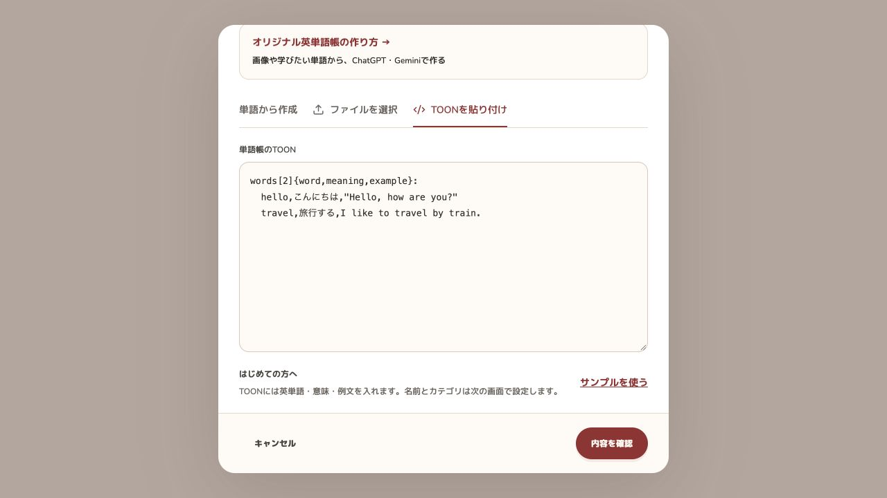

# Azuki

[](https://azuki.mame-app.com)

教科書のテスト範囲をまとめたり、例文を自分の覚えやすい場面に変えたり、クラスの友達と共有したり。**自分に合う単語帳を作って、学んで、共有できる**オープンソースの英単語帳アプリです。

**[Azukiを使う](https://azuki.mame-app.com) · [公開単語帳を探す](https://azuki.mame-app.com/explore)**

## 作る、覚える、共有する

| カードで覚える | 単語をまとめて登録する |
| --- | --- |
|  |  |
| 日本語→英語・英語→日本語を選び、順番どおりでもシャッフルでも練習できます。日本語訳付きの例文を読むカードもあります。 | 英単語・意味・例文をTOONでまとめて登録。名前・カテゴリ・教材名・版は画面で設定できます。 |

| 公開単語帳を自分の学習に | 画像やテーマから作る |
| --- | --- |
|  |  |
| コピーせず使うなら**お気に入り**へ。編集するなら**コピー・フォーク**して、自分用の意味や例文に変えられます。作った単語帳はリンクで共有できます。 | 作成ガイドのプロンプトをChatGPTやGeminiなどに渡し、画像・単語・テーマから作成。出力内容を確認してAzukiに取り込みます。 |

*画像は機能の紹介用イメージです。実際の画面とは異なる場合があります。*

## もっと、自分に合う学び方に

- **本をめくるように読む** — パソコンでは見開き、スマートフォンでは1ページずつ。意味をぼかして隠し、タップで確認できます。
- **例文を育てる** — マイライブラリから意味・例文を直接編集。1語につき10件まで、英語の例文と日本語訳を登録できます。
- **TOONを編集してフォーク** — 公開単語帳のTOONを外部AIに渡して、好きな場面や物語の例文に書き換えることもできます。
- **標準単語帳から始める** — CEFR-J A1〜B2の8冊とテーマ別5冊を、例文・日本語訳と一緒に学習できます。
- **お気に入りからすぐ開く** — 元の単語帳へのショートカットをマイライブラリに表示。単語を複製せず、元の更新も反映されます。
- **学習の積み重ねを見る** — 今日・直近7日間の学習時間、日別グラフ、よく学習した単語帳を確認できます。カード・例文カード・本型学習が対象で、非表示・放置時間は除きます。記録は機能公開後から蓄積されます。
- **Googleアカウントで保存** — 自分の単語帳やお気に入りをクラウドに保存。公開単語帳の閲覧・学習は、ログインなしで利用できます。

標準単語帳の閲覧・学習と、お気に入りの登録は、個人の単語保存上限に含まれません。コピーして編集した単語帳は保存上限の対象です。

## プルリクエストを歓迎します

不具合の修正、UIの改善、機能追加、ドキュメントの整備、単語の意味・例文の修正など、**Issue・プルリクエストを受け付けています**。小さな修正も歓迎します。大きな機能追加は、実装前にIssueで相談してください。

始め方や確認事項は [CONTRIBUTING.md](CONTRIBUTING.md)、脆弱性の連絡先は [SECURITY.md](SECURITY.md) を参照してください。

## ローカルで動かす

[.nvmrc](.nvmrc) に記載したNode.js 22.23.4とnpmを使います。開発・CI・デプロイのビルドは同じバージョンに揃えています。22系は22.23.4以降が必要です（[eMudhra関連の証明書対策を含むセキュリティ更新](https://nodejs.org/en/blog/release/v22.23.4/)）。

```sh
git clone https://github.com/ta1yo1022/Azuki.git
cd Azuki
nvm install
nvm use
npm ci
npm run dev
```

**http://127.0.0.1:5173/explore** から公開単語帳を検索・閲覧できます。自分の単語帳の登録・編集にはGoogleログインが必要です。

ログインやAPIを開発する場合は、[SETUP.md](SETUP.md) に従って自分のFirebaseプロジェクトとローカルD1を設定してください。このリポジトリの本番用設定を、そのまま自分の公開先に使わないでください。

## テスト・ビルド

```sh
npm test
npm run build
```

いずれも実行前に標準単語帳の静的データを生成します。チェックイン済みの入力を使うので、辞書の再ダウンロードは不要です。PRではGitHub Actionsがテストとビルドを実行します。本番公開はメンテナーによるmainへのマージ後に実行され、PRからはデプロイしません。

## 単語のTOON

単語だけを入力してProで意味・例文・日本語訳を作る場合：

```toon
words[3]: agree,curious,improve
```

意味や例文を含めて取り込む場合：

```toon
words[2]{word,meaning,example}:
  hello,こんにちは,"Hello, everyone."
  travel,旅行する,I like to travel by train.
```

英単語だけの自動作成は1回500語まで。通常の単語帳の取り込みは5,000語・512KBまでです。配列の件数と字下げを検証します。複数の例文・日本語訳は `examples` に格納し、画面のひな形をコピーして使えます。作成ガイド・フォーク編集・AIへの入出力もTOONです。

## 構成

| パス | 内容 |
| --- | --- |
| `src/` | React・TypeScript・Viteによる画面、Firebase認証、公開単語帳の閲覧・学習 |
| `worker/` | Cloudflare WorkersのAPI・認証・メール配信 |
| `shared/` | 型・TOON入出力・データ検証・画面とAPIの共通処理 |
| `migrations/` | Cloudflare D1のマイグレーション |
| `content/official/` | テーマ別の標準単語帳の編集元 |
| `content/cefrj/` | CEFR-Jの原典情報・意味・例文の編集元 |
| `tests/` | UI・ルーティング・API・SQL・教材データのテスト |
| `.github/` | PR・Issueテンプレート、CI/CD |

標準単語帳の修正もPRで受け付けています。編集先は [テーマ別単語帳](content/official/README.md) と [CEFR-J](content/cefrj/README.md) の説明を参照してください。`public/content/` と `shared/*-catalog.json` は生成物です。

## ライセンスと出典

Azukiの独自コードと開発ドキュメントは **[MIT License](LICENSE)** で公開しています。教材・画像・ブランド資産には別の条件があります。詳細は [THIRD_PARTY_NOTICES.md](THIRD_PARTY_NOTICES.md) を参照してください。

- **CEFR-J**：東京外国語大学投野由紀夫研究室の独自の利用条件が適用されます。MIT・CC0として再許諾するものではありません。[原典の利用条件](content/cefrj/SOURCE-README.txt)と出典表示を維持してください。
- **EJDict**：辞書データは [CC0 1.0](content/official/EJDict-LICENSE.txt) です。
- **StPageFlip**：MIT。ライセンスを [src/vendor/page-flip.LICENSE](src/vendor/page-flip.LICENSE) に同梱しています。
- **Azuki・Volta Technologiesの名称・ロゴ**：MITによるコードの利用許可に、商標・公式サービスを名乗る権利は含まれません。独自公開時は自分の名称・ロゴ・問い合わせ先を用意してください。

公開サービスの利用には [利用規約](https://azuki.mame-app.com/terms) と [プライバシーポリシー](https://azuki.mame-app.com/privacy) が適用されます。ユーザーが登録した非公開データはこのリポジトリに含まれません。

運営：Volta Technologies · お問い合わせ：support@volta.jp

### ページのメタデータ

公開単語帳のタイトル・説明・語数を、Cloudflare Pages FunctionsがHTMLのtitle・description・OGP・Twitter Cardに反映します。`shared/metadata.ts`をブラウザと配信側で共有し、アプリ内で移動した場合も更新します。共有画像は`public/og-image.png`です。

`/shared/:id/study`・`/shared/:id/book`の正規URLは単語帳の詳細ページです。非公開ページはnoindex、公開されていない単語帳は情報を出さず404、取得障害時は503を返します。Pages Functionsの確認には、ビルド後に`npx wrangler pages dev dist --port 8790`を利用できます。通常のViteサーバーではブラウザ側の更新のみ動作します。

### 英単語の音声

Google Cloud Text-to-SpeechのWaveNet（`en-US-Wavenet-F`）で、再生を要求した英単語だけを生成します。例文の音声はまだ生成しません。生成済み音声（WAV／MP3）は非公開R2バケット`azuki-audio`へ保存し、正規化した単語とモデルバージョンのハッシュで再利用します。APIは保存された単語IDから本文を解決し、非公開単語帳は毎回所有権を確認します。R2は直接公開しません。

API Workerに`AUDIO`バインディング、`AUDIO_ENABLED=true`とSecret `GOOGLE_TTS_API_KEY`が必要です。Google Cloudで課金とCloud Text-to-Speech APIを有効にし、専用キーのAPI制限をCloud Text-to-Speech APIにしてください。ローカルは`.dev.vars`へ設定、本番は`npx wrangler secret put GOOGLE_TTS_API_KEY --config wrangler.api.jsonc`で登録します。キーを`VITE_`変数やGitへ保存しないでください。旧MeloTTSとはR2の保存先を分けており、切り替え後の初回再生でWaveNet音声を生成します。新規環境は`npx wrangler r2 bucket create azuki-audio`でバケットを作成し、D1マイグレーションを適用してください。生成は同じ音声ごとにロックし、失敗時は保存しません。新規生成の初期上限は販売開始前はアカウントごと単語100件、販売開始後は無料で単語10件・例文5件／日（UTC、日本時間9時リセット）。Proでは個人の1日上限なし。アプリ全体の安全上限は3,000件／日で、生成済み音声の再生は上限に含めません。新規生成はログイン必須で、公開・非公開の両経路で同じアカウントの枠を使用します。残り件数はマイライブラリに表示し、日本時間9時にリセットします。全体上限は`AUDIO_DAILY_GENERATION_LIMIT`で変更できます。音声APIはPOSTで利用し、返却形式は生成音声に合わせた`audio/wav`または`audio/mpeg`です。ローカルでもGoogleの音声生成を呼び出すため、無料枠を超えると利用料金が発生します。

### Azuki Pro（Stripe）

月額480円（税込）の月額プランのみです。販売開始後の無料枠は新規生成が単語10個・例文5個／日で、生成済みの再生は枠に含めません。Proは新規生成の個人上限なし、本型学習が利用できます。フォルダ・例文のAI作成などは有料機能に含めていません。

`BILLING_ENABLED=false`の間は販売を開始せず、既存の単語100件／日と本型学習を維持します。Stripeの本番審査・販売者情報・特商法表記を確認するまで、本番はfalseのままにしてください。

ローカルの`.dev.vars`には`STRIPE_SECRET_KEY`（sk_test_）、`STRIPE_WEBHOOK_SECRET`（whsec_）、`STRIPE_PRICE_ID`、任意の`STRIPE_PORTAL_CONFIG_ID`を設定します。本番のシークレットはWorker Secretsへ登録し、価格ID・ポータル設定ID・`BILLING_ENABLED`はWorkerの設定へ登録します。価格はJPY480・月額・税込み（inclusive）であることをサーバーで検証します。フロントから送られた価格やユーザーIDは採用しません。

Webhookは`POST /api/billing/webhook`です。`checkout.session.completed`、`checkout.session.async_payment_succeeded`、`customer.subscription.created/updated/deleted`、`invoice.paid/payment_failed/payment_action_required`を有効にします。未加工の本文の署名と時刻を検証し、顧客ごとのロックでStripeの最新契約を再取得します。重複・順不同の通知でも古い状態へ戻さず、失敗時は503でStripeに再送させます。サーバーが対応付けた顧客・設定した価格・環境が一致し、有効期間内のactive契約だけをProとします。test/liveの契約はDBでも分離します。

決済成功のURLやクライアント側の保存値ではProにしません。価格画面からサーバーで更新確認でき、カード変更・解約はStripe Customer Portalへ移動します。解約予約は支払済み期間まで有効、契約終了・past_due等では無料へ戻ります。保存済み単語帳を解約時に削除しません。

テストは`AZUKI_STRIPE_SMOKE=1 npx vitest run tests/stripe-integration.test.ts`で実行できます。実際のStripeテストAPIでCheckout・税込480円・二重申込防止・テスト課金・通知反映・解約・Portalを確認し、作成したテスト顧客と契約は終了時に削除します。sk_live_では実行できません。通常のテストとCIではこの外部接続テストをスキップします。ローカルWebhookはStripe CLIの`stripe listen --forward-to http://localhost:8787/api/billing/webhook`で転送します。秘密鍵をコマンド履歴に直接書かないでください。

音声生成は保存された単語・例文番号からサーバーで本文を解決し、本文の持ち込みは受け付けません。失敗した生成は個人枠を戻します。Proでも不正な連続生成を防ぐため1分に新規30件、全体の安全上限を設けています。R2の既存音声の再生には個人枠を適用しません。

### 1か月無料オファー

共通コード `AZUKI1MONTH` をプラン画面で適用できます。Googleの確認済みアカウントごとに1回のみ、適用から日本時間で暦上の1か月（翌月に同日がない場合は月末）Proを付与します。Stripeの顧客・契約・請求は作成せず、期限で権限が失効します。既存有料契約・決済手続き中は適用できません。テストと本番の権限は分離します。配布を停止する場合は `pro_offers.active=0` に更新します。停止は新規適用のみを止め、付与済み期間には影響しません。利用期限の記録は再利用防止のため保持します。

### 単語TOONから作成 / Proの意味・例文生成

`npm run content:dictionary` は同梱のCC0 EJDictソースを検索用26分割JSONにします（外部ダウンロード・DBへの辞書投入は不要）。生成物もリポジトリに含みます。Workerの `DICTIONARY` Assets bindingで配信し、`AI` bindingの `@cf/qwen/qwen3-30b-a3b-fp8` で意味の自動選択と例文・日本語訳の生成を行います。辞書にない語の意味はAIで生成します。追加の外部APIキーは不要です。

デプロイ前に `0025_vocabulary_generation.sql` を適用してください。`VOCABULARY_ENABLED=true` で有効、`VOCABULARY_DAILY_LIMIT=1000` はサービス全体の1日あたり試行語数の緊急上限（UTC日境界）です。AI bindingの呼出しはローカル開発でもCloudflare上で実行されます。

- 入力は `words[2]: agree,curious` のTOON配列。意味・例文・訳は生成後に編集できます。Freeでも意味を手入力して作成可能です。
- 意味・例文の自動作成は既存のPro判定を利用（無料オファーを含む）。1アカウント週500成功語、月曜0時JST更新。音声枠と独立。
- 1リクエスト20語、DBトリガーで生成前に枠を予約。同時実行を含め500語を超えず、失敗・期限切れは返却。部分成功のみ消費。同じ語の再生成は消費。
- リクエストIDはユーザーごとに保存し、通信再試行で二重生成・二重計上しません。完了結果は14日、週の集計は8週間程度保持。定期メンテナンスで削除。
- 意味・文・訳は保存前に確認・編集。クライアント指定の意味やプロンプトは生成入力に使わず、サーバーで辞書語義の候補を取得し、AIが辞書を参考に意味・例文・訳を作成します。未知語は日本語の意味もAI生成します。
