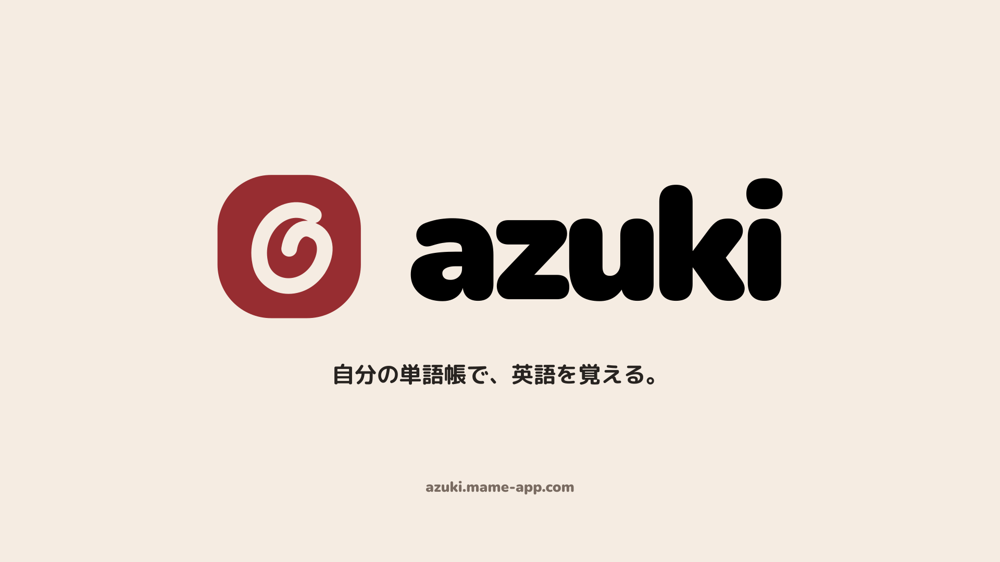
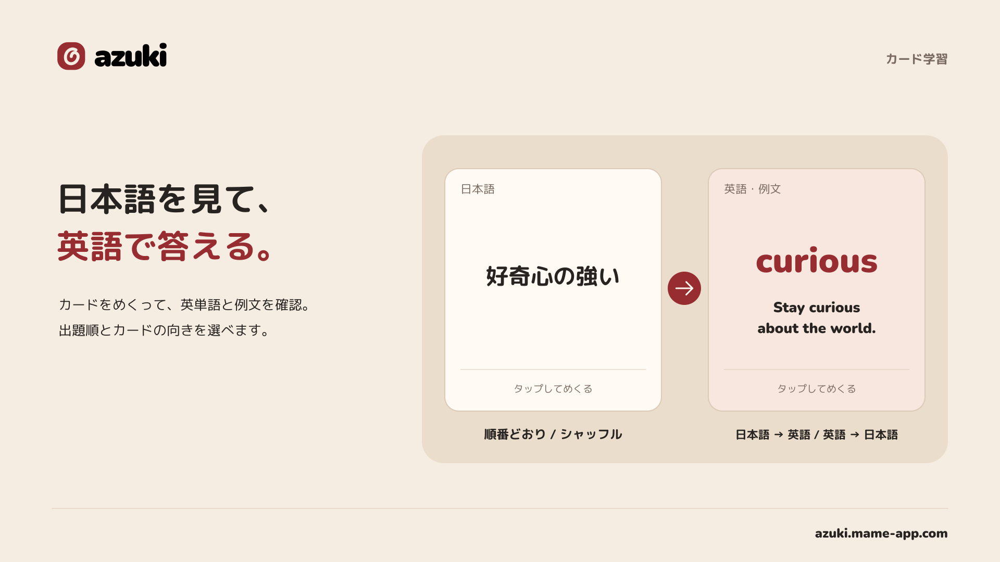
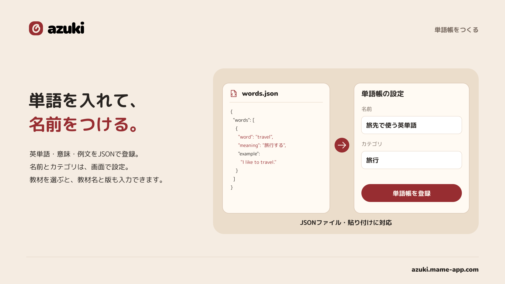
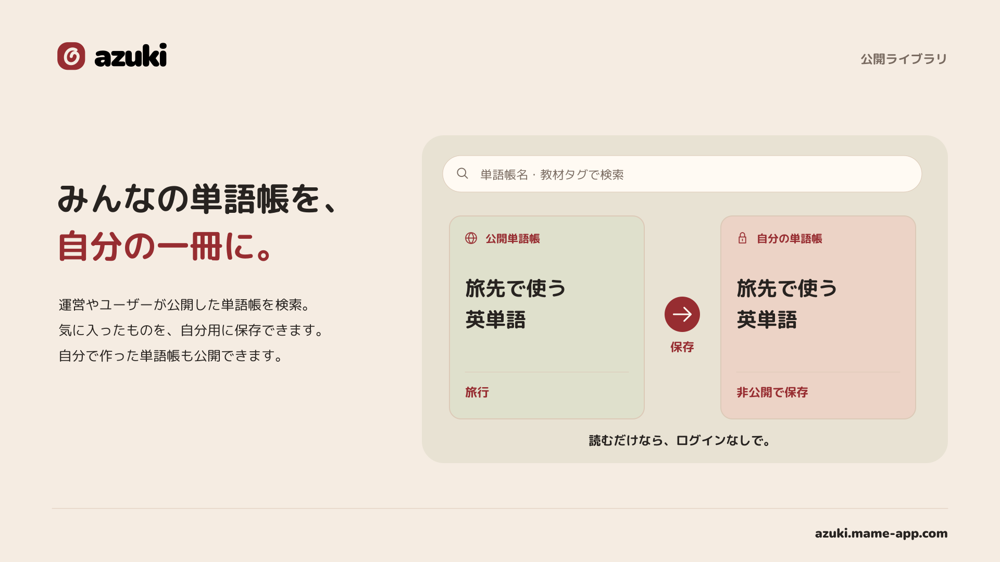
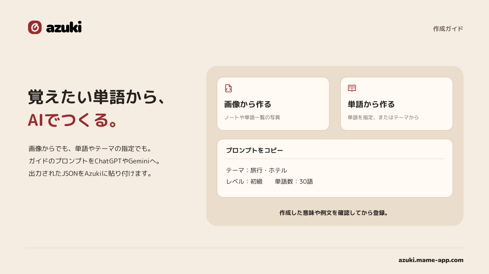

# Azuki

[](https://azuki.mame-app.com)

教科書のテスト範囲をまとめたり、例文を自分の覚えやすい場面に変えたり、クラスの友達と共有したり。**自分に合う単語帳を作って、学んで、共有できる**オープンソースの英単語帳アプリです。

**[Azukiを使う](https://azuki.mame-app.com) · [公開単語帳を探す](https://azuki.mame-app.com/explore)**

## 作る、覚える、共有する

| カードで覚える | 単語をまとめて登録する |
| --- | --- |
|  |  |
| 日本語→英語・英語→日本語を選び、順番どおりでもシャッフルでも練習できます。日本語訳付きの例文を読むカードもあります。 | 英単語・意味・例文をJSONでまとめて登録。名前・カテゴリ・教材名・版は画面で設定できます。 |

| 公開単語帳を自分の学習に | 画像やテーマから作る |
| --- | --- |
|  |  |
| コピーせず使うなら**お気に入り**へ。編集するなら**コピー・フォーク**して、自分用の意味や例文に変えられます。作った単語帳はリンクで共有できます。 | 作成ガイドのプロンプトをChatGPTやGeminiなどに渡し、画像・単語・テーマから作成。出力内容を確認してAzukiに取り込みます。 |

*画像は機能の紹介用イメージです。実際の画面とは異なる場合があります。*

## もっと、自分に合う学び方に

- **本をめくるように読む** — パソコンでは見開き、スマートフォンでは1ページずつ。意味をぼかして隠し、タップで確認できます。
- **例文を育てる** — マイライブラリから意味・例文を直接編集。1語につき10件まで、英語の例文と日本語訳を登録できます。
- **JSONを編集してフォーク** — 公開単語帳のJSONを外部AIに渡して、好きな場面や物語の例文に書き換えることもできます。
- **標準単語帳から始める** — CEFR-J A1〜B2の8冊とテーマ別5冊を、例文・日本語訳と一緒に学習できます。
- **お気に入りからすぐ開く** — 元の単語帳へのショートカットをマイライブラリに表示。単語を複製せず、元の更新も反映されます。
- **学習の積み重ねを見る** — 今日・直近7日間の学習時間、日別グラフ、よく学習した単語帳を確認できます。カード・例文カード・本型学習が対象で、非表示・放置時間は除きます。記録は機能公開後から蓄積されます。
- **Googleアカウントで保存** — 自分の単語帳やお気に入りをクラウドに保存。公開単語帳の閲覧・学習は、ログインなしで利用できます。

標準単語帳の閲覧・学習と、お気に入りの登録は、個人の単語保存上限に含まれません。コピーして編集した単語帳は保存上限の対象です。

## プルリクエストを歓迎します

不具合の修正、UIの改善、機能追加、ドキュメントの整備、単語の意味・例文の修正など、**Issue・プルリクエストを受け付けています**。小さな修正も歓迎します。大きな機能追加は、実装前にIssueで相談してください。

始め方や確認事項は [CONTRIBUTING.md](CONTRIBUTING.md)、脆弱性の連絡先は [SECURITY.md](SECURITY.md) を参照してください。

## ローカルで動かす

[.nvmrc](.nvmrc) に記載したNode.js 22系とnpmを使います。

```sh
git clone https://github.com/ta1yo1022/Azuki.git
cd Azuki
npm ci
npm run dev
```

**http://127.0.0.1:5173/explore** から公開単語帳を検索・閲覧できます。自分の単語帳の登録・編集にはGoogleログインが必要です。

ログインやAPIを開発する場合は、[SETUP.md](SETUP.md) に従って自分のFirebaseプロジェクトとローカルD1を設定してください。このリポジトリの本番用設定を、そのまま自分の公開先に使わないでください。

## テスト・ビルド

```sh
npm test
npm run build
```

いずれも実行前に標準単語帳の静的データを生成します。チェックイン済みの入力を使うので、辞書の再ダウンロードは不要です。PRではGitHub Actionsがテストとビルドを実行します。本番公開はメンテナーによるmainへのマージ後に実行され、PRからはデプロイしません。

## 単語のJSON

作成画面では、単語の配列を貼り付けられます。単語帳名やカテゴリは画面で設定します。

```json
[
  {
    "word": "accomplish",
    "meaning": "達成する",
    "examples": [
      {
        "text": "We accomplished our goal together.",
        "translation": "私たちは一緒に目標を達成しました。"
      }
    ],
    "tags": []
  }
]
```

従来の単一例文 `example` と、`schemaVersion`・`title`・`words` を持つ形式も読み込めます。例文カードは日本語訳付きの例文が対象です。1冊の上限は5,000語・取り込みは512KB、個人の保存上限は20冊・15,000語です。1日の登録数に上限はありません。標準単語帳の閲覧・学習は保存上限に含まれません。

## 構成

| パス | 内容 |
| --- | --- |
| `src/` | React・TypeScript・Viteによる画面、Firebase認証、公開単語帳の閲覧・学習 |
| `worker/` | Cloudflare WorkersのAPI・認証・メール配信 |
| `shared/` | 型・JSON検証・画面とAPIの共通処理 |
| `migrations/` | Cloudflare D1のマイグレーション |
| `content/official/` | テーマ別の標準単語帳の編集元 |
| `content/cefrj/` | CEFR-Jの原典情報・意味・例文の編集元 |
| `tests/` | UI・ルーティング・API・SQL・教材データのテスト |
| `.github/` | PR・Issueテンプレート、CI/CD |

標準単語帳の修正もPRで受け付けています。編集先は [テーマ別単語帳](content/official/README.md) と [CEFR-J](content/cefrj/README.md) の説明を参照してください。`public/content/` と `shared/*-catalog.json` は生成物です。

## ライセンスと出典

Azukiの独自コードと開発ドキュメントは **[MIT License](LICENSE)** で公開しています。教材・画像・ブランド資産には別の条件があります。詳細は [THIRD_PARTY_NOTICES.md](THIRD_PARTY_NOTICES.md) を参照してください。

- **CEFR-J**：東京外国語大学投野由紀夫研究室の独自の利用条件が適用されます。MIT・CC0として再許諾するものではありません。[原典の利用条件](content/cefrj/SOURCE-README.txt)と出典表示を維持してください。
- **EJDict**：辞書データは [CC0 1.0](content/official/EJDict-LICENSE.txt) です。
- **StPageFlip**：MIT。ライセンスを [src/vendor/page-flip.LICENSE](src/vendor/page-flip.LICENSE) に同梱しています。
- **Azuki・Volta Technologiesの名称・ロゴ**：MITによるコードの利用許可に、商標・公式サービスを名乗る権利は含まれません。独自公開時は自分の名称・ロゴ・問い合わせ先を用意してください。

公開サービスの利用には [利用規約](https://azuki.mame-app.com/terms) と [プライバシーポリシー](https://azuki.mame-app.com/privacy) が適用されます。ユーザーが登録した非公開データはこのリポジトリに含まれません。

運営：Volta Technologies · お問い合わせ：support@volta.jp

### ページのメタデータ

公開単語帳のタイトル・説明・語数を、Cloudflare Pages FunctionsがHTMLのtitle・description・OGP・Twitter Cardに反映します。`shared/metadata.ts`をブラウザと配信側で共有し、アプリ内で移動した場合も更新します。共有画像は`public/og-image.png`です。

`/shared/:id/study`・`/shared/:id/book`の正規URLは単語帳の詳細ページです。非公開ページはnoindex、公開されていない単語帳は情報を出さず404、取得障害時は503を返します。Pages Functionsの確認には、ビルド後に`npx wrangler pages dev dist --port 8790`を利用できます。通常のViteサーバーではブラウザ側の更新のみ動作します。

### 英単語の音声

Google Cloud Text-to-SpeechのWaveNet（`en-US-Wavenet-F`）で、再生を要求した英単語だけを生成します。例文の音声はまだ生成しません。生成済み音声（WAV／MP3）は非公開R2バケット`azuki-audio`へ保存し、正規化した単語とモデルバージョンのハッシュで再利用します。APIは保存された単語IDから本文を解決し、非公開単語帳は毎回所有権を確認します。R2は直接公開しません。

API Workerに`AUDIO`バインディング、`AUDIO_ENABLED=true`とSecret `GOOGLE_TTS_API_KEY`が必要です。Google Cloudで課金とCloud Text-to-Speech APIを有効にし、専用キーのAPI制限をCloud Text-to-Speech APIにしてください。ローカルは`.dev.vars`へ設定、本番は`npx wrangler secret put GOOGLE_TTS_API_KEY --config wrangler.api.jsonc`で登録します。キーを`VITE_`変数やGitへ保存しないでください。旧MeloTTSとはR2の保存先を分けており、切り替え後の初回再生でWaveNet音声を生成します。新規環境は`npx wrangler r2 bucket create azuki-audio`でバケットを作成し、D1マイグレーションを適用してください。生成は同じ音声ごとにロックし、失敗時は保存しません。新規生成の初期上限はアカウントごと100件・アプリ全体3,000件／日（UTC）で、生成済み音声の再生は上限に含めません。新規生成はログイン必須で、公開・非公開の両経路で同じアカウントの枠を使用します。残り件数はマイライブラリに表示し、日本時間9時にリセットします。全体上限は`AUDIO_DAILY_GENERATION_LIMIT`で変更できます。音声APIはPOSTで利用し、返却形式は生成音声に合わせた`audio/wav`または`audio/mpeg`です。ローカルでもGoogleの音声生成を呼び出すため、無料枠を超えると利用料金が発生します。
